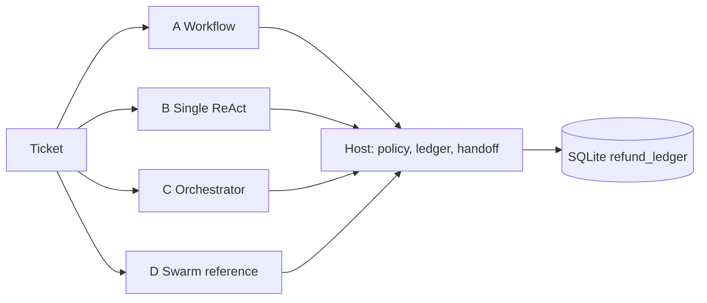

# Architecture

Tài liệu tham khảo về bốn shape và ranh giới code / model. Nhóm mô tả kiến trúc **của mình** ở mục 3 "Giải pháp" trong [`report/team/group_report.md`](../report/team/group_report.md). Báo cáo cả nhóm không quá 5 trang ngoài phụ lục.

## Bốn shape

- A — bước cố định trong Python. Model chỉ được soạn câu chữ. Tiền do `compute_compensation`.
- B — một vòng ReAct, tối đa 8 bước. Host kiểm tool và là người ghi duy nhất.
- C — orchestrator lập kế hoạch; investigator chỉ có tool đọc, nhận handoff allowlist.
- D — swarm có sẵn. Đo cost và variance. Không coi là shape thắng sẵn.

## Ranh giới

| Việc | Ai quyết |
| --- | --- |
| Lọc theo principal, policy hiệu lực, trần tiền | Code |
| Đọc ticket mơ hồ, có nên hỏi thêm không | Model, trong bound |
| Approval, idempotency, ghi refund | Code, một transaction |
| Trần hoàn tiền theo đơn (trừ phần claim trước đã nhận) | Code, đọc lại tổng trong cùng transaction ghi |
| Approval có thuộc đúng claim không | Code (`claims.approval_id` → `approvals.claim_id`) |
| Duyệt hay không | Approval event do host gắn, không do model tạo |
| Retry sau crash | Ledger, không phải checkpoint đơn độc |

## Handoff

`handoff.v1` chỉ còn các field allowlist. `parent_secret`, header, history, và tool ghi không được có mặt. Tóm tắt bằng LLM không tính là redaction.

## Phần tích hợp thành viên B

# Kiến trúc tích hợp Lab08

Tài liệu nền: [architecture.md](architecture.md), [contracts.md](contracts.md).

## Shape C
    get_claim_view → make_handoff → readonly investigators → quote → host issue_refund → finish

Handoff là gói giao việc như phiếu chuyển bàn: chỉ chứa mã yêu cầu, nhiệm vụ và dữ kiện cho phép.
Worker chỉ có công cụ đọc. Orchestrator gọi host; model không tự quyết tiền hoặc ghi ledger.
Host là quầy kiểm chi: kiểm approval, trần theo đơn và khóa refund:{claim_id}, rồi ghi tiền/audit cùng transaction.
Trace chỉ ghi gói đã lọc, quote và quyết định; không ghi ticket/context thô hoặc dữ liệu cá nhân.

## Ranh giới chỉnh sửa
- Antigravity: orchestrator.py và test_member_b_handoff_security.py.
- Codex: tích hợp, thực nghiệm trong bonus/, báo cáo và review.
- Giữ nguyên workflow/single của Giang trừ lỗi đã xác minh cần sửa khi tích hợp.
- Không thay đổi host, policy, evaluator, config hoặc dữ liệu đề bài.

## Nghiên cứu
Ưu tiên R2: phân loại lỗi swarm seed 55 và ablation tắt cơ chế ghi đè delay từ ticket,
giữ cùng MockLLM, dữ liệu, seed, giá, tool registry và evaluator.
Biến thể nằm ngoài shape tham chiếu; không sửa nguồn swarm được cấp.
